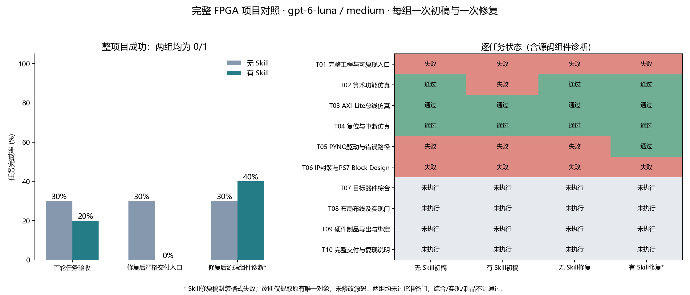
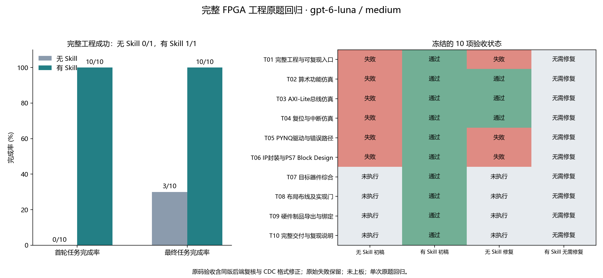
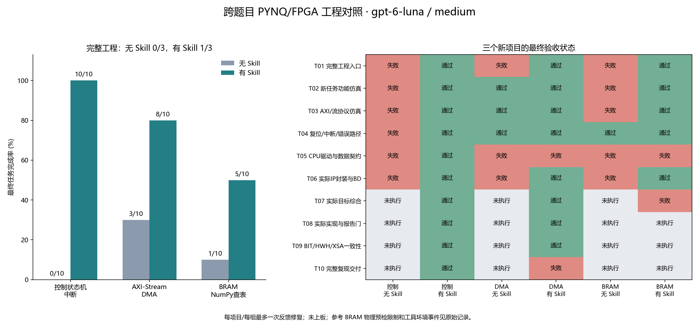

# 基于 Zynq 的实物光路交互系统优化过程

本工程以 Zynq-7020 为处理平台，完成摄像头图像采集、实物姿态检测、光路计算、HDMI 叠加显示及电脑网页交互。优化围绕检测重复计算、Portal 局部处理容量、显示等待和串口传输展开，并采用 Linux/PYNQ 实现 version14 板端程序。使用 PYNQ 实现后由 Python 管理硬件与帧缓冲生命周期，C 保留检测、姿态稳定、光路和协议逻辑，电脑端继续承担网页服务与游戏会话。

五物块完整姿态包由 404 字节缩减至 130 字节，在 115200 bit/s、8N1 条件下，理论线传输时间由 35.069 ms 降至 11.285 ms。软件优化和 PYNQ 实现沿用同一 PL 硬件基线，未新增检测加速 IP。以下分别列出直接可比的协议指标、软件资源变化和使用 PYNQ 实现后的实际阶段耗时。

## 一 测试条件与统计口径

摄像头保持双 lane、1280×720、RAW10/BGGR 输入，软件检测使用 BGR888 图像。采集与显示各采用三个帧槽，行有效数据为 3840 字节，DMA 步长为 5760 字节。板端姿态稳定支持间隔为 350 ms；电脑端场景准入上限为 600 ms，校时质量上限为 250 ms。三个参数分别控制姿态确认、游戏输入有效性与时钟映射质量。

检测耗时、相邻采集间隔、串口线传输时间和显示阶段耗时按各自边界统计。协议对比使用相同物块数量和完整包边界；线传输时间按每字节 1 位起始位、8 位数据位及 1 位停止位计算。板端运行数据来自已归档的实际运行记录，主机等价性检查与板端计时分列。

## 二 瓶颈定位与优化实施

### 1 检测路径与重复计算

早期 AprilTag 路径的分项采样中，阈值处理、连通域、梯度聚类和四边形拟合的阶段耗时中位数分别为 34.190、116.301、472.047 和 502.241 ms，主要开销集中在梯度聚类与四边形拟合。后续恢复彩色主体与端点标记检测：Mirror 使用黄色主体及黑色端点，Portal 使用蓝色或橙色主体及白色实心点、圆环，WALL 保留成对白条，Target 使用绿色圆形边界。该调整改变了检测方法与实物标记条件，两条路径的记录不用于计算同算法加速比。

彩色检测先对 4×4 像素块求 BGR 均值，在 320×180 网格上建立共享 HSV 和颜色掩码。Target 直接使用共享绿色掩码，取消独立的重复颜色换算。主体候选形成后，Portal 在原分辨率局部区域内验证标记，保留实心点、圆环、相对位置及歧义检查。

HSV 整数换算进一步采用 24 位倒数表，将适用范围内的逐像素除法改为整数乘法与移位；初始化时生成 256 项 32 位表，共占 1024 字节。Portal 局部扫描同时改为按行推进地址，减少逐像素索引除法和取模。对全部 16,777,216 种 8 位 RGB 组合的检查表明，优化前后 H、S、V 输出逐项一致，原有取整规则与颜色判定条件保持一致。

### 2 Portal 局部工作区

原实现将全分辨率 Portal 局部区域与 320×180 采样网格共用容量限制。倾斜物体的轴对齐包围框扩大后，可能在标记检查前因容量不足被拒绝。优化后为两个 Portal 顺序复用一套 512×512 有界工作区，包含局部掩码、颜色位、亮度和连通域队列。区域容量由 57,600 像素提高至 262,144 像素，达到原来的 4.55 倍，新增专用静态存储为 1.75 MiB。

局部结果缓存同时供标记连通域与亮度检查使用。该改动以固定内存开销覆盖倾斜后的局部区域，区域越界、多候选和布局歧义仍按原验证规则处理。

### 3 采集与显示调度

原调度在显示提交后串行等待退休，再进入下一轮采集。优化后采用提交与轮询分离的方式，在等待下一帧采集期间检查上一帧显示退休，使两段等待在安全条件下重叠。待退休帧槽继续保持占用，只有原退休栅栏完成后才能复用；整幅画布完成后才提交显示。

诊断输出采用有界队列，并在采集等待期间排出，姿态和控制消息保持完整报文边界。开始、重置和选关请求优先于周期校时，控制超时从实际完整写入串口后计算。显示保留与有效输入分别管理，保留画面继续使用原采集时间和帧号，不参与新观测确认或游戏计分。

DMA 退出使用实际状态确认。AMD PG020 说明，清除运行位后，状态寄存器的 Halted 置位可能存在延迟，因此软件结束请求与 DMA 已停止需要分别判断。 工程仅在对应 DMA 停止状态得到确认后释放其缓冲区。

### 4 串口协议压缩

串口由文本 v2 改为带长度字段、COBS 编码及 CRC32 校验的二进制 v3。COBS 通过消除负载中的分隔字节并限制编码附加开销，为字节流提供可恢复的报文边界。 本工程的原始包长度小于 254 字节，COBS 编码增加 1 字节，完整包长还计入前导和末尾边界。

每个物块采用 12 字节记录，包含类型、有效标志、中心、方向、长度和宽度。中心按 1/16 像素、尺寸按 1/8 像素、角度按一周 65,536 格量化。报文保留原始采集代次、帧序、采集时间、发布时间及质量掩码，并绑定电脑关卡、会话代次和 nonce。无效或待确认输入只发送当前状态，不附带保留姿态。

940 份原始完整场景的量化重放中，优化前后通关结果、光路终止类型和光段数量均无差异，最大光段坐标分量差为 0.23371 像素。该数值描述协议量化对计算结果的影响，不代表摄像头定位精度。

### 5 PYNQ 硬件编排

使用 PYNQ 实现后，Python 3.6 统一管理 Overlay、MMIO、GPIO、相机参数和缓冲区，命令行与 Notebook 共用同一 Session。C 通过平台回调复用原显示退休状态机，逐像素检测、姿态稳定和 v3 协议继续在原 C 核心执行。

共享缓冲区按物理地址、跨度、步长和所有权校验。PYNQ 官方文档区分物理连续分配、设备地址和缓存一致性，并规定非一致性缓冲区的 flush 与 invalidate 方向。 本工程针对目标旧版内核使用经检查的非缓存 xlnk 映射，采集和显示各保留三槽，释放仍受实际 DMA 停止状态约束。

## 三 优化前后性能对比

**表 1 完整姿态报文的传输开销**

| 场景物块数 | v2 包长 B | v3 包长 B | 包长缩减 | v2 线传输 ms | v3 线传输 ms |
|---|---:|---:|---:|---:|---:|
| 0 | 124 | 70 | 43.55% | 10.764 | 6.076 |
| 3 | 292 | 106 | 63.70% | 25.347 | 9.201 |
| 5 | 404 | 130 | 67.82% | 35.069 | 11.285 |

注：包长包含校验、编码和边界；时间按包长×10÷115200×1000 计算。五物块报文每次减少 23.785 ms 的理论线占用，不包含采集、检测、排队、系统调度及页面呈现时间。

**表 2 检测与调度实现对比**

| 项目 | 优化前 | 优化后 | 验证结果或统计边界 |
|---|---|---|---|
| HSV 整数换算 | 逐像素整数除法 | 倒数表乘法与移位 | 16,777,216 种 RGB 输出完全一致 |
| Target 颜色处理 | 独立颜色换算与检测 | 复用共享绿色掩码 | 保留圆形边界验证 |
| Portal 区域容量 | 上限 57,600 像素 | 上限 262,144 像素 | 容量扩大 4.55 倍 |
| 显示退休等待 | 与下一轮采集串行 | 采集等待期间轮询退休 | 保留原退休栅栏及帧槽占用 |
| 姿态量化重放 | 文本几何表示 | 12 字节物块记录 | 940 场景判定一致 |

表 2 的调度与运算项记录已经完成的实现变化；未由独立配对计时确定的收益不折算为帧率提升。

## 四 优化前后资源对比

FPGA 逻辑资源按 LUT、寄存器、BRAM 和 DSP 分类统计，DDR 缓冲与处理器静态数组另计。这一分类与 AMD UG906 的资源利用率报告口径一致。 软件优化及本次 PYNQ 实现使用相同的 BIT/HWH，故 PL 映射资源无增减。

**表 3 软件优化及 PYNQ 实现的资源变化**

| 资源项目 | 优化前 | 优化后 | 变化 |
|---|---:|---:|---:|
| HSV 倒数表 | 0 B | 1024 B | 增加 1 KiB |
| Portal 专用局部数组 | 0 B，复用已有数组 | 1,835,008 B | 增加 1.75 MiB |
| 三槽采集 DDR | 12,441,600 B | 12,441,600 B | 0 B |
| 三槽显示 DDR | 12,441,600 B | 12,441,600 B | 0 B |
| PL LUT 与寄存器 | 既有硬件基线 | 相同硬件基线 | 增量均为 0 |
| PL BRAM 与 DSP | 既有硬件基线 | 相同硬件基线 | 增量均为 0 |

注：Portal 专用数组按 512×512×（3 个 uint8＋1 个 uint32）计算，由两个 Portal 顺序复用。单组帧槽按 3×5760×720 计算，包含行内填充，两组合计 24,883,200 B。表中 DDR 为指定帧槽容量，不是进程总内存；PL 项统计相同硬件基线上的版本增量。

这一阶段的资源取舍是增加固定局部缓存，减少重复换算、重复扫描和串行等待。三槽容量及 PL 映射保持不变，优化收益主要来自处理器端的数据复用、调度和协议压缩。

## 五 PYNQ 运行结果

使用 PYNQ 实现后的实际十帧运行在 Python 3.6.5、ARMv7、Linux 5.4 环境完成，返回帧数为 10，允许安全退出，首故障记录为空。实际时钟读回约为 100.000、142.857 和 200.000 MHz。阶段计时如下。

**表 4 PYNQ 十帧运行阶段耗时**

| 计时阶段 | 样本数 | 平均值 ms | 中位数 ms | 最大值 ms |
|---|---:|---:|---:|---:|
| 采集及取得 CPU 帧副本 | 10 | 200.702 | 180.548 | 389.161 |
| C 处理及画布合成 | 10 | 89.488 | 90.140 | 95.768 |
| 显示阶段 | 10 | 42.938 | 42.790 | 50.677 |

注：计时值来自实际板端运行的终端输出归档。各阶段按运行入口定义统计，不将阶段均值相加后取倒数作为端到端帧率。89.488 ms 为 C 处理及画布合成的整体均值，不单独标为检测耗时。

本次优化已形成明确的量化结果：完整姿态包缩减 43.55%～67.82%，HSV 全域输出保持一致，Portal 局部容量扩大至原来的 4.55 倍，采集和显示帧槽总容量保持 24,883,200 字节。PYNQ 十帧记录验证了使用 PYNQ 实现后的采集、C 处理、显示及安全退出路径；系统持续运行状态另经实际使用确认。

## 六 技能优化的三轮对照验证

以下三图依次展示初次评估、优化后原题回归和跨项目验证，评估模型均为 gpt-6-luna / medium。各组最多进行一次反馈修复；图中记录的是离线工程验收结果，三轮均未上板。

### 1 初次评估

初次评估中，无 Skill 与有 Skill 两组的整项目成功数均为 0/1。修复后，有 Skill 组的源码组件诊断完成率为 40%，严格交付入口完成率仍为 0%；两组均未通过 IP 准备门，后续综合、实现和制品验收未执行。

*图 1 技能初次评估：任务完成率与逐项验收状态*

### 2 优化后原题回归

优化后的原题回归中，有 Skill 组初稿完成全部 10 项验收，无需反馈修复，完整工程成功数为 1/1；无 Skill 组初稿为 0/10，反馈修复后为 3/10，完整工程成功数为 0/1。图中保留原始失败状态，源码验收包含同版后端复核与 CDC 格式修正。

*图 2 技能优化后原题回归：任务完成率与十项验收状态*

### 3 跨项目验证

跨项目验证覆盖控制状态机与中断、AXI-Stream DMA、BRAM NumPy 查表三个新项目。有 Skill 组的最终任务完成数依次为 10/10、8/10、5/10，无 Skill 组依次为 0/10、3/10、1/10；完整工程成功数分别为 1/3 和 0/3。逐项状态显示，DMA 项目仍有 CPU 驱动与完整交付缺口，BRAM 项目仍有驱动、目标综合及后续验收缺口。

*图 3 跨项目验证：三个新项目的任务完成率与最终验收状态*
