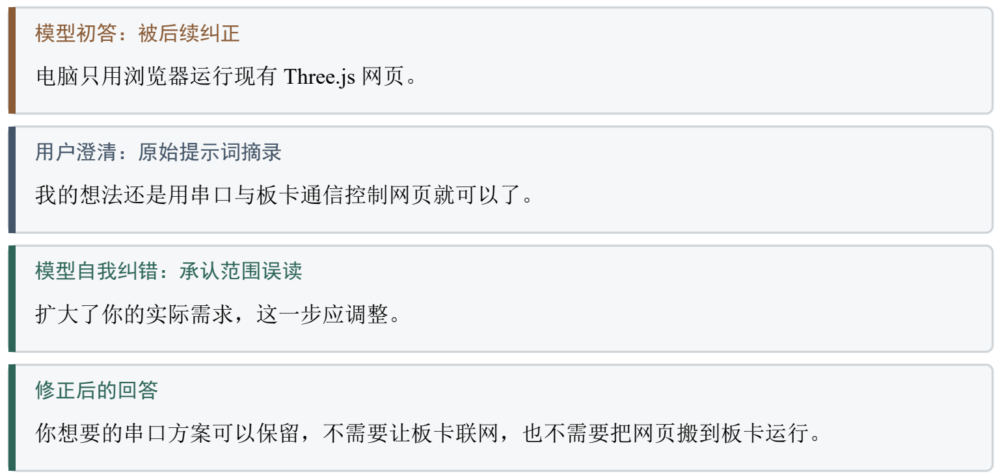
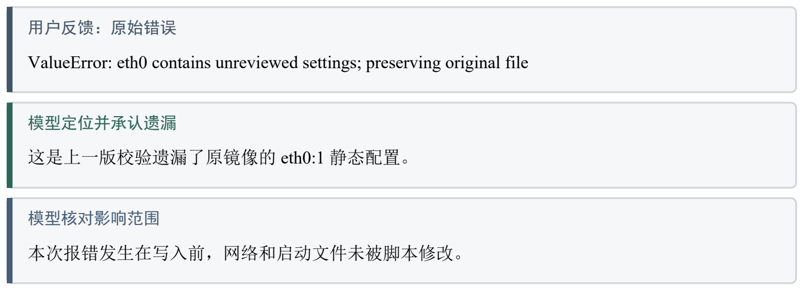
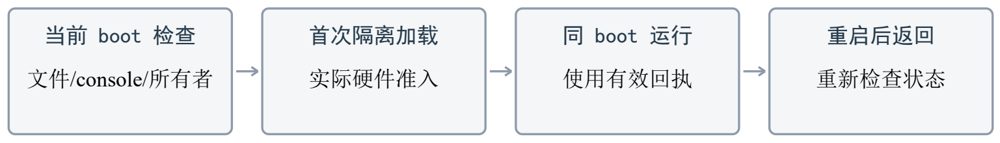
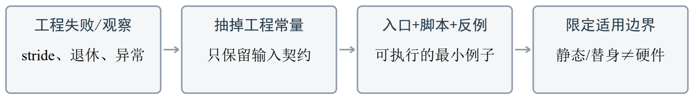
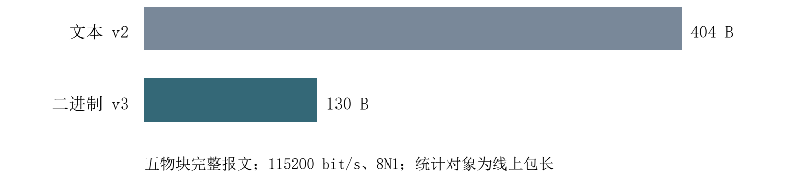
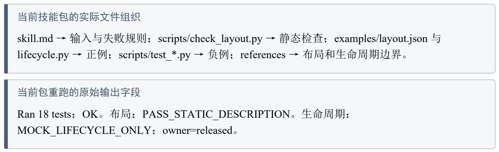

# 大模型协作记录

工程实现期间的提示词、模型回答、纠错与技能提炼

## 1  记录范围与证据口径

本记录围绕“参考裸板逻辑，在 PYNQ 环境下实现实物交互光路工程”展开，选取工程完成期间的原始协作：需求澄清、C/Python 接入、部署工具修正、硬件准入与技能提炼。案例按原始反馈、模型判断、实际修正及验证结果组织。

提示词与回答按原始会话摘录，不补写事后对话。为保持可读性，图中只重排相关句子，不仿造聊天软件截图。人工负责现场条件、取舍、操作和结果反馈；模型辅助定位代码、生成局部实现及检查工具。引用编号对应第 7 节的证据索引。

## 2  提示词与模型回答：如何确定实现范围

### 2.1  案例一：模型扩大范围，用户纠正后收缩

初始要求是使用 PYNQ 并保留网页效果。模型把“不再增加电脑桌面工程”误读为“电脑仅留浏览器”，进而提出板上 Web 后台和完整游戏会话。用户明确仍用串口控制电脑网页，模型随即承认扩大需求，并重写分工。[E1]



*图 1  范围误读与修正的真实对话摘录*

来源：[E1]。引号内为工程期原句摘录；本图是重新排版的摘录图，非聊天界面截图。

修正结果为：PYNQ 管理板端相机、Overlay、缓冲和 C 调用，电脑保留原后台、权威 C 游戏会话及 Three.js 网页，双方仍以 UART v3 交互。板端 Python 3.6 的兼容要求不再扩大到电脑网页依赖，原有检测、防抖与光路逻辑继续复用。

### 2.2  案例二：把抽象分工变成可验证接口

用户给出的实现约束：“保留检测器、B 防抖、Portal 规则、串口编解码和画面保持逻辑。”

用户明确 PYNQ 的实际职责：“Python 3.6 负责 Overlay、参数配置、帧缓冲生命周期和流程调度，逐像素检测继续调用 C。”

模型据此补充 Linux 时钟、UART、C ABI 与 Python ctypes 入口，使 Python 负责硬件编排，C 继续处理逐像素检测、B 防抖、Portal 规则、串口编解码和画面保持。Notebook 与常驻程序共用 Session，形成单一设备所有者。[E2]

模型阶段回答：“9 项新增离线测试、原 C 回归及 ARM ABI 检查通过；库依赖满足目标镜像 GLIBC 2.27 的版本上限。”

该回答同时限定了验证层级：当时 C 库检查通过，真实采集/显示后端尚未接通。后续分别接入硬件所有者、实际准入和十帧设备测试，没有把单一编译结果作为整个设备流程的证明。工程保留原始帧序、时间和关卡身份，避免使用处理完成时刻替代采集时刻。

**表 1  提示词约束到代码与验证的对应**

| 协作输入 | 模型形成的产物 | 对应核对 |
| --- | --- | --- |
| 保留既有算法与协议 | C ABI、POSIX 时钟/UART、Python 入口 | ARM ABI、目标 GLIBC、协议及原 C 回归 |
| PYNQ 实际管理硬件 | Overlay/MMIO/GPIO、非缓存三槽与共用 Session | 布局与所有权模型、Python 3.6 语法 |
| 原 v3 交互契约 | 保留关卡/代次/nonce、READY/START 与原始戳 | console/getty/已有 FD 检查、独占打开 |

## 3  自我纠错轨迹：错误、证据与修正

### 3.1  目标运行库不匹配：从“能编译”改为“匹配目标”

首版 ARM 库引入 GLIBC 2.35，而目标镜像为 GLIBC 2.27。模型在依赖检查中拒绝该制品，转而从原镜像提取 2.27 的 libc、libm 和加载器作为主机链接输入，重新编译并检查导入版本。原始首版库仍保留，其 ELF 中可读到 GLIBC_2.35；修正版仅需 2.4、2.7、2.17 等目标可满足版本。[E3]

**表 2  模型输出在证据约束下的修正**

| 初次实现/判断 | 暴露问题 | 修正及边界 |
| --- | --- | --- |
| 默认交叉链接得到 SO | 目标系统不具备 GLIBC 2.35 | 改用目标镜像链接库；不改板卡系统库 |
| 文件/编译检查通过 | 硬件所有者尚未绑定 | 先标识 CPU 检查，再接实际硬件层 |
| 完成一次加载即可反复准入 | 接口已打开时重复 qualify 被拒绝 | 区分首次加载与同 boot 正常运行 |

### 3.2  网络模板遗漏：真实失败推动工具修正

部署工具最初未覆盖镜像的 DHCP 主接口与 eth0:1 静态别名组合。用户运行后返回 ValueError，模型确认拒绝发生在写入之前，承认校验遗漏，修订模板以保留原网络文件，仅调整控制台启动配置。第二版留下 12 项主机回归记录，随后由用户返回重启与控制台状态。[E4]



*图 2  部署模板失败后的自我纠错*

来源：[E4]。错误未发生在摄像头帧处理阶段；修正的是部署匹配规则。

### 3.3  重复准入：修正的不只是代码，还有操作契约

用户再次运行后的问题：“结果从能正常运行变成错误。是不是要提前设什么。”

模型承认此前说明不足：“当前准入工具只支持接口隔离时首次加载。我之前没有把这个限制说明完整。”

当时真实返回显示 level_shifters=15、接口已经打开，隔离加载入口据此拒绝重复执行。模型随后把“先 qualify 再 run”改为按状态分支：首次隔离加载产生本 boot 回执，同次有效回执用于 run；重启后重新核对，不沿用旧启动身份。命令中增加阶段提示，避免把进入前台运行后的安静终端误认成准入卡住。[E5]



*图 3  由重复准入失败提炼的操作状态顺序*

图为对工程期最终操作契约的整理；不是新增的自动服务或自动重试功能。

## 4  技能包的提炼与验证

本节对应提交目录 `skill/` 中的 `pynq-dma-contract`，不把工程期多技能试验包写成当前交付数量。当前包由一个技能入口、布局检查器、布局样例、生命周期替身、正反例测试及两份参考说明组成。提炼目标是把相机工程中的交接经验转成其他图像或流式工程可使用的契约。[S1]

### 4.1  从哪些失败和观察中总结

**表 3  从工程观察到通用技能规则**

| 工程约束或模型反例 | 提炼到当前包的规则 | 如何核对 |
| --- | --- | --- |
| 有效行字节与 DMA 步长不同 | 分别输入行字节、步长和跨度，保留行填充 | 检查器拒绝跨度不足；逐行复制测试保留填充 |
| flush/PARK/指针变化不能证明退休 | 同步与完成分开；槽按明确所有权交接 | 设备槽/冲突访问/重叠布局负例 |
| start 抛异常仍可能已触发设备 | 提交前移交所有权，异常不回退为 CPU | 部分启动异常测试保留 device 状态 |
| stop 请求不等于实际停止 | 确认 halted、非 running 且无 error 才释放 | 超时、状态错误、迟到状态均不释放 |

通用化时移除了物块类别、固定光源、相机阈值、板卡固定地址及游戏 JSON 依赖。示例只处理 bytearray 和合成地址描述；设备地址必须来自真实分配器，缓存及停机 API 由目标平台适配。当前静态 schema 限于同一地址空间、线性整字节像素及整行分配，不覆盖 SG、地址别名、压缩或平面格式。



*图 4  当前 DMA 技能包的提炼路径*

### 4.2  验证有效性与失效边界

对当前提交的技能包复核得到 18 项主机测试通过：布局类 7 项、生命周期类 11 项。布局例子输出 PASS_STATIC_DESCRIPTION，生命周期例子输出 MOCK_LIFECYCLE_ONLY。这说明输入拒绝、行复制、应用所有权和失败分支符合描述，不证明真实 DMA 已退休或完成缓存同步。[S2]

**表 4  技能验证与设备验证分别计数**

| 验证层级 | 结果 | 不能扩大的结论 |
| --- | --- | --- |
| 静态布局与 CPU 生命周期 | 18 项测试通过；正例输出符合约定 | 不是板卡 DMA/VDMA 停机实测 |
| 工程期独立技能审查 | 当时 8+15+9=32 项离线检查通过 | 不当作当前单技能包的测试数 |
| 目标设备十帧记录 | frames=10、can_exit=true、first_fault=null | 不代替跨板通用性或长期 FPS |

对于真实 PYNQ 驱动，阻塞式 stop 不能直接冒充示例里的非阻塞 request_stop。异常、超时、未知缓存语义或地址域时，技能保留所有者，不把线程超时当作设备已停止。生命周期例子的释放规则只对其替身接口成立，实际平台仍须提供对应的退休与排空依据。

### 4.3  工程期间的智能体工作流

当时用户明确授权的审查任务：“子智能体独立审查与试用，发现遗漏和暴露使用问题”

历史会话记录显示，技能入口先由主智能体精简，随后才按用户授权进行三路独立审查。审查发现层级 IP 地址混归属、矛盾累计耗时、UTF-8 BOM、工作目录/主机 Python 说明、DMA 长度/TLAST 与 Python/C 数组布局等遗漏，主智能体合并修订并重跑离线检查。[E6]


*图 5  工程期间实际发生的技能审查流程*

来源：[E6]。图中为工程期间的审查流程；当前提交的单项 DMA 技能与当时的多技能试验包分别核对。

## 5  优化过程：性能与资源前后对比

工程实现阶段的性能工作集中于共享 HSV、Portal 局部工作区、显示等待和串口报文。其中可直接按同一线上边界比较的是协议包长；相机识别总延迟没有成对实机计时，故不计算整体加速倍数。下面将理论传输、静态资源和实际十帧采样分列，避免以编排层变化代替实测加速。[P1]

**表 5  完整报文包长与理论线传输时间**

| 物块数 | v2/B | v3/B | v2/ms | v3/ms |
| --- | --- | --- | --- | --- |
| 0 | 124 | 70 | 10.764 | 6.076 |
| 3 | 292 | 106 | 25.347 | 9.201 |
| 5 | 404 | 130 | 35.069 | 11.285 |



*图 6  五物块报文优化前后包长*

理论时间=字节数×10÷115200×1000。五物块 404→130 B，缩减 67.82%；理论线占用 35.069→11.285 ms。

**表 6  软件优化阶段的资源对比**

| 资源/实现项 | 优化前 | 优化后 |
| --- | --- | --- |
| HSV倒数表 | 0 B | 1024 B |
| Portal局部工作区 | 57600像素 | 262144像素 |
| Portal专用静态数组 | 复用已有数组 | 1835008 B |
| 采集与显示各三槽 | 24883200 B | 24883200 B |
| PL硬件输入 | 既有BIT/HWH | 同一BIT/HWH |

Portal 局部容量提高到原来的 4.55 倍，专用数组增加 1.75 MiB；两组三槽 DDR 总量为 2×3×5760×720=24883200 B。该阶段使用同一 BIT/HWH，PL 配置资源增量为零，没有据此声称 PL 资源下降或检测帧率提升。HSV 倒数表的等价性检查覆盖全部 16777216 种 RGB，保留原取整规则。[P1]

**表 7  工程完成期间的 PYNQ 设备分项采样**

| 实际十帧阶段 | 样本 | 均值/ms | 最大/ms |
| --- | --- | --- | --- |
| 采集与 CPU 副本 | 10 | 200.702 | 389.161 |
| C 处理与画布合成 | 10 | 89.488 | 95.768 |
| 显示提交与退休 | 10 | 42.938 | 50.677 |

十帧输出来自当时用户返回的真实 SSH 记录，覆盖采集、C 处理、显示及安全退出。这些均值不是纯检测耗时，也不相加取倒数当作持续 FPS。用户后续确认工程成功，模型记录的是现场确认，不补写缺少的全程性能数据。

## 6  复现：从工程输入到协作结果

### 6.1  准备与主机检查

输入为完整 `pynq_web_v14` 目录；电脑使用 Windows、PowerShell、Python 3.12，运行 C 主机程序需配套 EXE 或 Visual Studio C++ 工具。

板卡为 AX7Z020B，使用配套 PYNQ 2.6.2/Python 3.6.5 镜像、OV5640 双通道相机、HDMI 和 USB-UART；硬件输入为运行目录中的冻结 Overlay。

在工程包根目录打开 PowerShell。先建立电脑环境并检查网页入口：

```powershell
$Package = (Get-Location).Path
$Project = Join-Path $Package 'src/project'
python -m venv .venv
$Py = Join-Path $Package '.venv/Scripts/python.exe'
& $Py -m pip install -r build/requirements_host_locked.txt
& "$Project/start_web.ps1" -Check -PythonPath $Py
```

在同一终端验证当前提交的技能包，命令只访问主机数据：

```powershell
Push-Location "$Package/skill"
& $Py -B pynq-dma-contract/scripts/check_layout.py pynq-dma-contract/examples/layout.json
& $Py -B pynq-dma-contract/examples/lifecycle.py
& $Py -B -m unittest discover -s pynq-dma-contract/scripts -p 'test_*.py' -v
Pop-Location
```

预期结果依次为 PASS_STATIC_DESCRIPTION、MOCK_LIFECYCLE_ONLY、18 tests / OK。修改布局样例中的 stride 为小于 width×bytes_per_pixel，或使两槽地址重叠，检查器应拒绝；该负例不连接板卡。

### 6.2  部署与本次开机准入

板卡先从 AX7Z020B 配套 PYNQ 系统卡启动；已有匹配系统时保留其启动文件。断电连接相机、HDMI、USB-UART 与网线。相机使用彩色主体与端点标记，实体光源不必摆放，诊断光源为 (32,500) 向右。通过网线建立 SSH 管理连接，游戏仍走 UART。完整环境和接线图文见同目录《复现说明.pdf》。

```powershell
$Board = Read-Host '输入板卡SSH地址（用户名@地址）'
ssh $Board 'mkdir -p /home/xilinx/jupyter_notebooks/beam_v14'
scp -r "$Package/board/runtime/." "${Board}:/home/xilinx/jupyter_notebooks/beam_v14/"
ssh $Board
```

以下在板卡 SSH 终端执行。首次配置必须已具备独立 SSH 通道，再审查控制台与原网络配置：

```bash
cd /home/xilinx/jupyter_notebooks/beam_v14
python3 -B beam_v14.py --inspect
sudo python3 -B beam_v14.py --check
sudo python3 -B beam_v14_deploy_v2.pyz --audit
```

若 ttyPS0 仍被控制台占用且原镜像配置匹配，使用已有备份/回滚工具处理一次；返回 changed=[boot] 后重启并重新 SSH 登录。未知配置被拒绝时保留原始输出，使用第 3.2 节的匹配核对方法。

```bash
sudo python3 -B beam_v14_deploy_v2.pyz --apply-config
sudo reboot
```

重新登录后，在本次开机第一次实际加载前执行：

```bash
cd /home/xilinx/jupyter_notebooks/beam_v14
sudo -v
sudo -n true
cat /proc/sys/kernel/random/boot_id
sudo python3 -B beam_v14.py --check
sudo python3 -u -B beam_v14_ready_v2.pyz --qualify
```

实际准入返回 ADMITTED_FROM_ACTUAL_HARDWARE 后运行。若同次开机已完成准入，直接使用有效回执，不重复 qualify；重启则重新检查。此顺序正对应第 3.3 节的纠错结论。

```bash
sudo python3 -u -B beam_v14.py --run
```

### 6.3  网页交互、退出与源码复核

电脑在原 PowerShell 中确认实际串口号，再启动网页。串口只由该后台独占；按选关、开始计时、移动物块、目标命中、结算和返回选关逐步观察。

```powershell
Get-CimInstance Win32_SerialPort | Select-Object DeviceID,Name
& "$Project/start_web.ps1" -SerialPort COM9 -PythonPath $Py
```

打开 http://127.0.0.1:8765/。COM9 仅为示例，以实际枚举为准。结束时正常停止电脑后台，板端按 Ctrl+C 请求原安全排空，检查 frames、can_exit、first_fault；can_exit=true 才表示该所有者正常释放。保存本次准入输出、运行 JSON 和后台 UART 原始日志，不能用电脑的 KeyboardInterrupt 推断板卡已停机。

源码复核采用包内构建入口，先准备 Vitis 2023.1 的 ARM Linux 交叉编译器和相同系统镜像中的目标链接库。以下参数由实际工具安装位置填写，输出使用新的目录：

```powershell
$ArmCc = (Get-Command arm-linux-gnueabihf-gcc.exe).Source
$Image = (Resolve-Path '../ax7z020b-2.6.0.img').Path
$Tools = "$Project/color_test/software/vision_ps_baremetal/tools"
$Libs = "$Project/output/repro_target_libs"
$BuildOut = "$Project/output/repro_c"
$CheckOut = "$Project/output/repro_checks"
& $Py -m pip install dissect.extfs==3.15 dissect.util==3.24 `
  dissect.cstruct==4.7
& $Py -B "$Tools/prepare_beam_target_libs.py" `
  --image $Image --output $Libs
& $Py -B build/build_c.py --project $Project --output $BuildOut `
  --arm-cc $ArmCc --target-libs $Libs
& $Py -B sim/run_checks.py --project $Project --output $CheckOut `
  --host-library "$BuildOut/beam_pynq_host.dll"
```

这一步复核同一 C/Python 边界、ABI 与主机回归，实际设备结果由板端运行给出。原镜像和链接库作为固定输入保留。



*图 7  当前技能包的文件与验证输出对照*

来自实际文件和主机输出的摘录排版；示例地址是合成输入，未配置真实 DMA。

## 7  证据索引与验收要点对应

**表 8  原始证据与本文内容对应**

| 编号 | 原始材料与定位 | 本记录使用方式 |
| --- | --- | --- |
| E1 | 工程期初始方案与用户串口澄清对话 | 图1；明确模型初答被纠正 |
| E2 | 工程期 C入口、Python硬件编排、v3契约提示与回答 | 表1；接口产物和阶段结论 |
| E3 | 首版/修正版 ARM库及修正版 build.json | 导入版本失败与目标链接库修正 |
| E4 | 网络模板异常、模型回答、第二版12项回归记录 | 图2；写入前拒绝和模板遗漏 |
| E5 | 重复qualify原始STOPPED输出与模型承认说明不足 | 图3；首次加载和同boot运行分开 |
| E6 | 工程期技能精简及用户授权的独立审查对话 | 图5；审查分工和遗漏修正 |
| S1/S2 | skill/pynq-dma-contract/入口、references、examples、scripts | 表3/4；当前包18项复验 |
| P1 | 串口协议文档、工程期优化记录、十帧stdout归档 | 表5/6/7；静态、理论和实测分列 |
